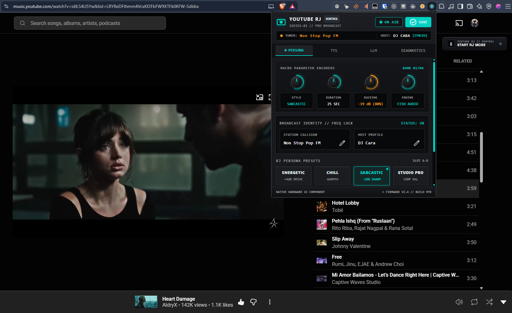

# 📻 YouTube Radio Jockey (RJ Mode)

[](https://www.typescriptlang.org/)
[](https://bun.sh)
[](https://developer.chrome.com/docs/extensions/)
[](https://www.native-instruments.com/)

> **Transform your YouTube music sessions into a live, personalized FM radio station with an intelligent AI Radio Jockey.**

YouTube Radio Jockey listens along to your YouTube playlists and acts as your live radio host—introducing upcoming songs, commenting on lyrics and artist trivia, reading out top YouTube comments, and smoothly ducking music volume like real broadcast hardware.

---



---

## ⚡ Highlights & Key Features

### 🎙️ Intelligent AI Radio Host (RJ)
- **Seamless Playlist Flow**: Automatically bridges songs on YouTube playlists by analyzing the current track and teasing the upcoming one.
- **Smart Pre-Buffering**: Synthesizes commentary and speech audio in the background ~10 seconds into a song so the audio is cached and ready to fire with zero lag ~30 seconds before track completion.
- **Context-Aware Dialogue**:
  - **🎵 Synced Lyrics via LRCLIB**: Automatically retrieves track lyrics to reference specific lines, themes, and emotional tone.
  - **💬 Live YouTube Comments**: Scrapes and mentions real viewer comments from the page for authentic broadcast banter.
  - **📜 Broadcast History Memory**: Remembers previous commentary segments in the session to avoid repetitive quips.

### 🎛️ Native Instruments Komplete Hardware Deck
- **Studio Hardware Aesthetic**: Built from the ground up with the look and feel of an anodized audio rack (rotary knobs with active SVG LED gauges, tactile Maschine-style backlit switches, and neon cyan status telemetry).
- **Macro Parameter Encoders**: Quick rotary access to **Style**, **Duration** (25s / 35s / 50s), **Audio Ducking** (-6dB to -24dB), and **TTS Engine**.
- **Module Selector Bank**:
  - `PERSONA`: Station callsign, host profile, persona presets, and logic switches.
  - `TTS`: Voice synthesis provider, reference voices, and voice emotion styles.
  - `LLM`: Multi-provider LLM engine switcher and custom model selection.
  - `DIAGNOSTICS`: Real-time system bus logs, API handshakes, and commentary JSON export.
- **Floating YouTube In-Page HUD**: An on-air hardware button pinned to YouTube with a pulsing cyan LED ring and a live 3-bar animated equalizer HUD showing synthesis activity.

### 🔊 Studio-Grade Audio Ducking
- **Web Audio API Gain Control**: Smoothly fades YouTube playback volume down to a user-defined level while the RJ speaks, and gently crossfades back to full volume when the host finishes.

### 🤖 Multi-Engine LLM Architecture
- **OpenRouter**: Full support for custom models (e.g. `recursive/flint-v1.0:free`, `meta-llama/llama-3.3-70b-instruct`, Claude, GPT-4o, etc.) with custom API keys.
- **Google Gemini**: Built-in support for ultra-fast Gemini 2.0 Flash (`gemini-2.0-flash`).
- **ChatJimmy**: Free, zero-setup Llama 3.1 access without requiring an API key.

### 🗣️ Multi-Provider Speech Synthesis (TTS)
- **Fish Audio**: High-fidelity, emotional zero-shot voice cloning with custom reference IDs.
- **Murf.ai**: Studio broadcast voices with 7+ emotional presets (*Promo*, *Conversational*, *Newscast*, *Friendly*, *Luxury*, *Sad*, *Angry*).
- **Google TTS**: Zero-configuration, free fallback voice synthesis.

### 🎭 RJ Persona Styles & Custom Identity
- **Station Callsign**: Customize your station branding (e.g. `Non Stop Pop FM`, `97.7 YouTube FM`, `Nightwave Plaza`).
- **Host Profile**: Name your radio host (e.g. `DJ Cara`, `Alexis`).
- **4 Persona Presets**:
  - **ENERGETIC** (`+4dB DRIVE`): High-energy, hype-building radio personality.
  - **CHILL** (`WARMTH`): Laid-back, smooth late-night FM vibe.
  - **SARCASTIC** (`-2dB SHARP`): Witty, dry humor with clever music banter.
  - **STUDIO PRO** (`COMP BAL`): Balanced, professional radio broadcaster.

### 🧪 Live Diagnostics & Telemetry
- **API Handshake Verification**: Test buttons for LRCLIB Lyrics, TTS Synthesis, and LLM completions.
- **System Bus Logs**: Real-time terminal output directly in the extension popup.
- **Export Commentary Logs**: One-click download of all generated session scripts with timestamps and song metadata as a structured JSON file.

---

### 🎵 YouTube Music Support
- Works on `music.youtube.com` playlists (and other list-based playback) in addition to `youtube.com`.
- Detects the current and upcoming tracks from the YouTube Music player bar and playlist shelf.
- All features (AI commentary, studio-grade ducking, multi-engine LLM/TTS, personas) work on YouTube Music.

---

## 📦 Installation

### Quick Install (No Coding / Build Required)

1. **[Download the latest ZIP](https://github.com/rayanfer32/youtube-radio-jockey/archive/refs/heads/main.zip)** and extract it to a folder on your computer.
2. Open your browser (Chrome, Brave, Edge, Opera) and go to `chrome://extensions/`.
3. Enable **Developer mode** using the toggle in the top-right corner.
4. Click the **Load unpacked** button in the top-left corner.
5. Select the **`dist`** folder inside the extracted folder.
6. The YouTube Radio Jockey icon will now appear in your browser toolbar!

---

### Build From Source (For Developers)

1. Clone the repository:
   ```sh
   git clone https://github.com/rayanfer32/youtube-radio-jockey.git
   cd youtube-radio-jockey
   ```

2. Install dependencies using [Bun](https://bun.sh):
   ```sh
   bun install
   ```

3. Build the production extension:
   ```sh
   bun run build
   ```

4. Load into Chrome / Brave / Edge:
   - Navigate to `chrome://extensions/`
   - Enable **Developer mode** in the top-right corner
   - Click **Load unpacked**
   - Select the `dist/` folder inside the project directory

---

## 🛠️ Development

Run the extension in watch mode for active development:

```sh
# Start development watcher (rebuilds src/ on save)
bun dev

# Build production bundle
bun run build
```

---

## 🔑 Recommended API Keys

| Service | Purpose | Requirement | Link |
| :--- | :--- | :--- | :--- |
| **OpenRouter** | Commentary Generation (Custom Models) | Optional (Recommended) | [openrouter.ai/keys](https://openrouter.ai/keys) |
| **Google AI Studio** | Gemini 2.0 Flash Commentary | Optional | [aistudio.google.com](https://aistudio.google.com/apikey) |
| **Fish Audio** | Natural Emotional TTS | Optional (Recommended) | [fish.audio](https://fish.audio/) |
| **Murf.ai** | Professional Studio Voices | Optional | [murf.ai/api](https://murf.ai/api/api-keys) |

*Note: ChatJimmy and Google TTS work out of the box with zero API keys required for quick testing.*

---

## 🎧 Suggested YouTube Playlists

To test the full radio experience with automatic transitions and track-to-track commentary, try a continuous music playlist:
- [Pop & Hits Radio Mix](https://www.youtube.com/watch?v=LjhCEhWiKXk&list=RDJGwWNGJdvx8&index=28)
- [Synthwave / Lofi Chill Station](https://www.youtube.com/watch?v=4xDzrJKXOOY&list=PLofht4PTcKYnaH8w5gkDC264ozRxBuBaW)

---

## 📄 License

MIT License. Designed with audio hardware love for YouTube music listeners.
